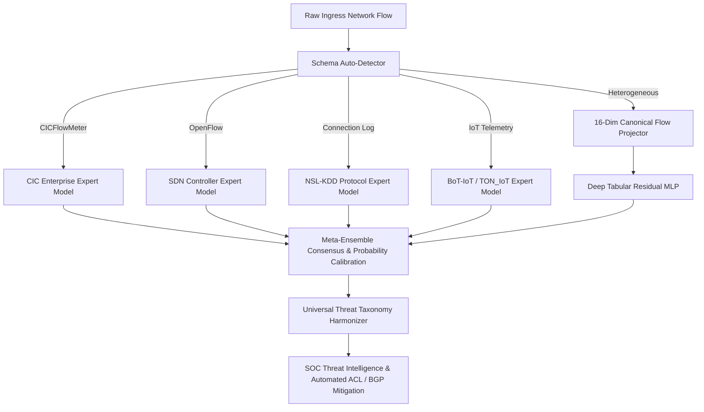

# Master Dataset Catalog & Benchmark Documentation: DDoS-AI

This document serves as the master specification catalog for all canonical DDoS and network intrusion datasets supported, downloaded, and benchmarked within the **DDoS-AI** platform.

Detailed individual specifications for each dataset are documented in dedicated specification files:
- [CIC-DDoS2019 Dataset Specification](datasets/cic_ddos2019.md)
- [CIC-IDS2017 Dataset Specification](datasets/cic_ids2017.md)
- [NSL-KDD Dataset Specification](datasets/nsl_kdd.md)
- [SDN-DDoS Dataset Specification](datasets/sdn_ddos.md)
- [BoT-IoT Dataset Specification](datasets/bot_iot.md)
- [TON_IoT Dataset Specification](datasets/ton_iot.md)

---

## 1. Master Comparative Benchmark Matrix

| Dataset ID | Full Title | Originating Institution | Domain Environment | Record Count | Features | Primary Attack Vectors | Direct Source / Mirror |
|---|---|---|---|---|---|---|---|
| **CIC-DDoS2019** | Canadian Institute for Cybersecurity DDoS 2019 | UNB (Canada) | Enterprise Volumetric | ~50M packets | 70 | Syn, UDP, UDPLag, DNS, LDAP, MSSQL, NetBIOS, NTP, SNMP, SSDP, TFTP, PortScan | [UNB Repository](https://www.unb.ca/cic/datasets/ddos-2019.html) |
| **CIC-IDS2017** | CIC Intrusion Detection Evaluation 2017 | UNB (Canada) | Enterprise Intrusion & DDoS | 225,745 flows | 78 | DDoS LOIC, DoS Hulk, DoS GoldenEye, Slowloris, Slowhttptest | [GitHub Mirror](https://raw.githubusercontent.com/deathtaco1231/NetworkSecurityProject/main/) |
| **NSL-KDD** | Modernized DARPA / KDD 99 Benchmark | UNB & defcom17 | Connection-Level Host/Net | 148,517 records | 41 | Neptune, Smurf, Pod, Teardrop, Land, Back, Satan, Portsweep | [defcom17 GitHub](https://raw.githubusercontent.com/defcom17/NSL_KDD/master/) |
| **SDN-DDoS** | Software-Defined Networking Telemetry | Univ of Blida & IEEE | OpenFlow Controller & Switches | 104,345 flows | 22 | Volumetric TCP SYN Flood, UDP Flood, ICMP Ping Flood | [aliasar1 GitHub](https://raw.githubusercontent.com/aliasar1/DDoS-Detection-SDN/master/) |
| **BoT-IoT** | Internet of Things Botnet Benchmark | UNSW Canberra Cyber | Smart Home & IoT Gateways | 72M records (5% sample) | 10 - 14 | DDoS TCP/UDP/HTTP, DoS TCP/UDP/HTTP, OS Fingerprinting | [dharaneishvc GitHub](https://raw.githubusercontent.com/dharaneishvc/Botnet-Threat-Detection-ML/main/) |
| **TON_IoT** | Telemetry of Things (IoT / IIoT) | UNSW Canberra Cyber | Industrial IoT & Smart Cities | Multi-GB telemetry | 12 - 44 | DDoS, DoS, Scanning, Backdoor, Injection, Ransomware, XSS | [UNSW Research](https://research.unsw.edu.au/projects/toniot-datasets) |

---

## 2. Multi-Dataset Single Connected Pipeline Architecture

In DDoS-AI, rather than training an isolated model for a single dataset, the platform **trains a specialized high-performance model for each dataset**, and subsequently links them into a **single connected pipeline** (`UnifiedDDoSPipeline`):



### Key Components of the Connected Pipeline:
1. **Schema Auto-Detector**: Automatically fingerprints incoming features to select the specialized native expert model ($O(1)$ routing).
2. **Canonical Flow Projector**: Standardizes heterogeneous fields into a 16-dimensional unified flow space (`flow_duration_ms`, `total_packets`, `total_bytes`, `packet_rate_pps`, `byte_rate_bps`, `packet_asymmetry`, `byte_asymmetry`, `syn_ratio`, `iat_mean`, etc.).
3. **Hierarchical Cascading Inference**:
   - **Tier 1 (Fast-Path Tree)**: Rapid tree screen ($< 0.05$ ms latency). Obvious normal traffic is passed immediately.
   - **Tier 2 (Domain Expert Model)**: Native specialized model evaluates the flow with domain-calibrated accuracy.
   - **Tier 3 (Deep Spatio-Temporal Verification)**: Tabular Residual MLP / Flow-Transformer resolves high-entropy boundary flows.
   - **Tier 4 (Meta-Ensemble Arbiter)**: Combines expert distributions to yield a calibrated confidence score.
4. **Automated Mitigation Action**:
   - `PASS`: Confidence $\ge 0.95$ Benign.
   - `CHALLENGE_SYN_COOKIE`: Low-confidence TCP flood.
   - `RATE_LIMIT_50PCT`: Medium-confidence volumetric flood.
   - `BGP_FLOWSPEC_SCRUB`: High-confidence reflection amplification.
   - `ACL_BLOCK_IP`: Confirmed persistent volumetric attack.

---

## 3. Operational CLI Usage

### Download Datasets
```bash
# Download / prepare all canonical datasets
python scripts/download_datasets.py --dataset all --mode sample

# Audit file integrity and data quality across all datasets
python scripts/verify_datasets.py
```

### Train Dataset-Specific Models
```bash
# Train models for each dataset (Apple Silicon MPS / CUDA / CPU accelerated)
python scripts/train_dataset_models.py --dataset all --epochs 5 --device auto
```

### Run Connected Unified Pipeline
```bash
# Execute end-to-end connected defense engine on live simulated multi-environment flows
python scripts/run_unified_pipeline.py --input demo --device auto
```
