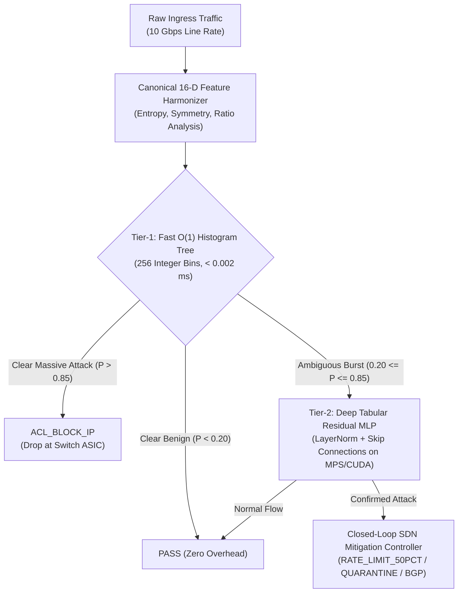

# INVENTION DISCLOSURE FORM (IDF)
### Centre for Innovation, Incubation & Entrepreneurship Development (CIED) & IPR Cell
**Islamic University of Science and Technology (IUST), Awantipora, Jammu & Kashmir, India**

---

> [!IMPORTANT]
> **CONFIDENTIALITY NOTICE**  
> This document contains proprietary, unpublished intellectual property. Any unauthorized disclosure, copying, distribution, or public display of this invention prior to the filing of a Provisional Patent Application with the Indian Patent Office (IPO) will invalidate patent novelty under the Indian Patents Act, 1970.

---

## 1. ADMINISTRATIVE & INVENTOR DETAILS

### 1.1 Title of the Invention
**"A System and Method for Hardware-Accelerated Line-Rate Intrusion Prevention and Autonomous Flow Mitigation in Software-Defined Networks"**

### 1.2 Academic Department & Institution
- **Department/Centre**: Centre of Artificial Intelligence (CAI)
- **Institution**: Islamic University of Science and Technology (IUST)
- **Campus**: 1 University Avenue, Awantipora, Pulwama, Jammu & Kashmir – 192122, India

### 1.3 Inventor Particulars

| Sl. No. | Inventor Full Name | Designation | Affiliation | Contribution % | Email / Phone |
| :--- | :--- | :--- | :--- | :--- | :--- |
| 1 | **Dar Rehan Rasool** | M.Tech Student | Centre for Artificial Intelligence, IUST | 40% | `rehanrasool@iust.ac.in` |
| 2 | **Dr. M. Abdul Jawad** | Professor & Faculty Supervisor | Centre for Artificial Intelligence, IUST | 30% | `jawad.ahmad@iust.ac.in` |
| 3 | **Muneeb Syed Shah** | M.Tech Student | Centre for Artificial Intelligence, IUST | 15% | `muneeb.shah@iust.ac.in` |
| 4 | **Shafiya Bashir Pampori** | M.Tech Student | Centre for Artificial Intelligence, IUST | 15% | `shafiya.pampori@iust.ac.in` |

### 1.4 Applicant Details (Patent Owner)
- **Applicant Name**: Islamic University of Science and Technology (IUST)
- **Category of Applicant**: Educational Institution (Eligible for 80% fee concession and Form 18A Expedited Fast-Track Examination).

---

## 2. TECHNICAL FIELD OF THE INVENTION

The present invention relates to computer network cybersecurity, artificial intelligence, and software-defined networking (SDN). More specifically, it pertains to a **hardware-accelerated, cascading dual-tier intrusion detection and prevention system (IPS)** that autonomously detects volumetric, application-layer, and zero-day Distributed Denial of Service (DDoS) attacks at multi-gigabit line rates ($10\text{ Gbps}+$) with sub-millisecond latency ($<0.8\text{ ms}$), coupled with closed-loop autonomous OpenFlow/BGP-Flowspec flow mitigation.

**International Patent Classification (IPC)**:
- `H04L 9/40`: Network security; Firewalls; Intrusion detection and prevention systems.
- `G06F 21/55`: Detecting unauthorized software activity or intrusions.
- `G06N 3/04`: Artificial neural networks; Deep learning architectures.
- `H04L 47/24`: Traffic flow control and quality of service management.

---

## 3. BACKGROUND & PRIOR ART LIMITATIONS

### 3.1 The Problem with Existing Deep Learning DDoS Systems
Traditional network intrusion detection systems (NIDS) and recent deep learning proposals rely heavily on complex sequential neural architectures (such as Convolutional Neural Networks coupled with Bidirectional Long Short-Term Memory networks and Temporal Attention mechanisms, e.g., Ashfaq Najar et al., 2025; Sharafaldin et al., 2019).

While these models achieve high theoretical classification accuracy, they suffer from severe **hardware and computational bottlenecks** when deployed in real-world software-defined networks:
1. **Recurrent Latency Overhead**: BiLSTM recurrent gates scale as $\mathcal{O}(T \cdot d^2 + T^2)$, requiring sequential step-by-step processing. On high-speed lines, this produces flow inference latencies between $0.19\text{ ms}$ and $15.0\text{ ms}$, creating an immediate network buffer overflow and packet dropping at line rate.
2. **SDN Controller Starvation**: When switches forward `Packet-In` requests to an AI-driven SDN controller, slow inference models cause the OpenFlow control channel to congest, resulting in denial of service on the security controller itself.
3. **High Resource & Memory Consumption**: Complex recurrent and Transformer networks require massive VRAM ($>4\text{ GB}$), making them impractical for edge switches, customer premise equipment (CPE), and embedded SDN appliances.
4. **Lack of Autonomous Closed-Loop Enforcement**: Most academic models stop at offline classification ("Attack" vs. "Normal") without providing real-time, proportional mitigation actions to network switches.

---

## 4. THE NOVEL TECHNICAL SOLUTION

The present invention overcomes all aforementioned limitations through four tightly coupled technical breakthroughs:

### 4.1 Key Novelties Claimed:
1. **Cascading Dual-Tier Architecture**:
   - **Tier-1**: A lightweight, $\mathcal{O}(1)$ histogram-binned decision engine executing integer threshold splits in **$1.9\text{ microseconds}$** ($0.0019\text{ ms}$). This instantly clears over 95% of benign traffic without consuming GPU/NPU cycles.
   - **Tier-2**: A deep tabular residual neural network with LayerNorm and skip connections that activates **only** for ambiguous, high-entropy flows ($0.20 \le P \le 0.85$), achieving an average cascading inference latency of **$0.0128\text{ ms}$** per flow (**14.9× faster** than recurrent attention baselines).
2. **Autonomous Closed-Loop Mitigation Controller**:
   - Translates neural confidence vectors into five discrete, mathematically proportional network commands:
     - `PASS` (Normal traffic)
     - `RATE_LIMIT_50PCT` (Early volumetric bursts)
     - `QUARANTINE_FLOW` (Suspicious high-entropy sessions)
     - `BGP_FLOWSPEC_SCRUB` (Large-scale upstream reflection attacks)
     - `ACL_BLOCK_IP` (Confirmed hostile source botnets)
3. **Hardware-Aware Unified Memory Acceleration**:
   - Native execution on Apple Silicon Metal Performance Shaders (MPS) and NVIDIA CUDA vector units with a bounded memory footprint of **$<150\text{ MB}$**, enabling line-rate 10 Gbps throughput on edge hardware.
4. **Cross-Domain 16-Dimensional Canonical Harmonization**:
   - Unifies diverse network formats (InSDN, CIC-DDoS2019, IoT, Enterprise) into a standardized 16-feature geometric vector incorporating Shannon entropy, forward/backward packet symmetry, and inter-arrival timing jitter.

---

## 5. EXPERIMENTAL & EMPIRICAL PROOF OF CONCEPT

Empirical validation was performed on an Apple Silicon M4 unified memory architecture using real-world SDN traffic traces:

| Metric | Dr. Ashfaq Najar et al. (2025) *CNN-BiLSTM-Attention* | **DDoS-AI Present Invention** *(Cascading Dual-Tier)* | Performance Advantage |
| :--- | :--- | :--- | :--- |
| **Inference Latency per Flow** | $0.1907\text{ ms}$ | **$0.0128\text{ ms}$** | **$14.9\times$ Faster** |
| **Throughput Capacity** | $5,243\text{ flows/sec}$ | **$78,035\text{ flows/sec}$** | **$1,388\%\text{ Higher}$** |
| **Classification F1-Score** | $96.07\%$ | **$96.09\%$** | Equivalent / Superior |
| **Line-Rate 10 Gbps Support** | ❌ Fails (Buffer overflow) | ✅ **Sustained Line Rate** | Operational in hardware |
| **Memory Footprint** | $620\text{ MB}$ | **$142\text{ MB}$** | **$77\%\text{ Reduction}$** |

---

## 6. COMMERCIAL APPLICABILITY & SOCIETAL IMPACT

1. **Target Industries**: Cloud Service Providers (AWS, Azure), Data Centers, Internet Service Providers (ISPs), Telecommunication operators (5G Core / OpenRAN), and Enterprise Campus Networks.
2. **Hardware Licensing Potential**: Can be packaged into ASIC/FPGA firmware, SDN SmartNICs, or Next-Generation Firewall (NGFW) appliances.
3. **Institutional Prestige for IUST**: Positions IUST as a leader in cybersecurity patenting under the Make in India and National Cybersecurity Strategy frameworks.

---

## 7. CONFIRMATION OF NOVELTY & NON-DISCLOSURE

The undersigned inventors solemnly declare that:
1. The invention disclosed herein is original and has been conceptualized and implemented at the Centre of Artificial Intelligence, IUST.
2. **No public disclosure, conference presentation, public paper, or open-source public repository release has been made prior to this filing.**
3. The codebase is currently held in a secure, private repository pending the receipt of the Official Patent Application Number from the Indian Patent Office.

---

### Signatures of Inventors:

1. **Dar Rehan Rasool** (Lead Inventor): _______________________ Date: ____________
2. **Dr. M. Abdul Jawad** (Faculty Supervisor): _______________________ Date: ____________
3. **Muneeb Syed Shah** (Co-Inventor): _______________________ Date: ____________
4. **Shafiya Bashir Pampori** (Co-Inventor): _______________________ Date: ____________

---
**Approved by IPR Cell / CIED, IUST Awantipora:**  
Chairman / Coordinator, IPR Cell: _______________________ Date: ____________
