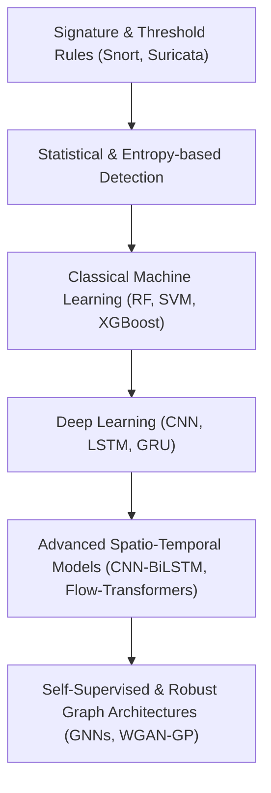

# Deep Learning and Machine Learning for DDoS Defense: A Systematic Survey

## 1. Introduction & Taxonomy of DDoS Attacks
Distributed Denial of Service (DDoS) attacks seek to exhaust target system resources (CPU, memory, socket descriptors, network bandwidth) by generating overwhelming floods of illegitimate traffic. Modern DDoS attacks are broadly categorized into three tiers:

1. **Volumetric Attacks (Layer 3/4)**:
   - **UDP Flood**: High-frequency transmission of UDP datagrams to random ports, forcing destination OS ICMP unreachable packet generation.
   - **ICMP Echo Flood**: Flooding network interfaces with ICMP Ping requests.
   - **TCP SYN Flood**: Abuse of the TCP 3-way handshake by leaving half-open connections pending in the OS listen backlog queue ($SYN \to SYN-ACK \to \text{timeout}$).
2. **Amplification & Reflection Attacks (Layer 4/7)**:
   - **DNS Amplification**: Exploiting open DNS resolvers using EDNS0 extensions (up to 54x amplification factor).
   - **NTP Monlist**: Requesting the last 600 client addresses via monlist query (up to 556x amplification factor).
   - **SNMP / SSDP / LDAP / CLDAP / MSSQL**: Exploiting connectionless UDP discovery queries to reflect amplification up to 70x.
   - **Memcached (CVE-2018-6389)**: UDP port 11211 amplification delivering factors up to 51,200x.
3. **Application Layer & Slow-Rate Attacks (Layer 7)**:
   - **HTTP GET/POST Floods**: High-rate valid HTTP requests targeting database-heavy dynamic endpoints.
   - **Slowloris**: Opening numerous HTTP connections and sending partial header bytes periodically to prevent connection timeouts while exhausting server worker threads.
   - **R-U-Dead-Yet (RUDY)**: Slow HTTP POST requests submitting message bodies at single-byte intervals.

---

## 2. Evolution of Detection Paradigms

### 2.1 Classical Machine Learning
- **Random Forests (RF)**: Operates by constructing an ensemble of orthogonal decision trees via bootstrap aggregating (bagging) and random subspace feature selection. Outstanding performance on static tabular flow statistics ($> 99.8\%$ accuracy), but high inference latency on large tree depths ($O(T \cdot D)$) and vulnerable to concept drift.
- **Support Vector Machines (SVM)**: Effective in high-dimensional feature spaces via RBF kernels, but suffers from $O(N^2 \sim N^3)$ training complexity, making it intractable for full 50-million-packet PCAP traces.
- **Gradient Boosted Decision Trees (XGBoost / LightGBM)**: The state-of-the-art tabular baseline. Utilizes 2nd-order Taylor expansions of the loss function, histogram-based binning, and sparsity-aware split finding. Demonstrates superior trade-offs between accuracy ($99.9\%$) and sub-millisecond per-flow inference.

### 2.2 Deep Learning Architectures
- **1D Convolutional Neural Networks (1D-CNN)**: Treats packet header sequences or flow statistics as spatial vectors, sliding kernels to capture local cross-feature correlations (e.g., relationship between TCP flags and window size).
- **Recurrent Architectures (LSTM / BiLSTM / GRU)**: Models temporal sequences of inter-arrival times (IAT) and packet lengths. Essential for capturing burst dynamics and distinguishing normal flash crowds from attack spikes.
- **Flow-Transformers**: Replaces recurrence with Multi-Head Self-Attention mechanisms ($QK^T / \sqrt{d_k}$), allowing the model to attend to long-range dependencies across multiple network flow windows without suffering vanishing gradients.
- **Deep Autoencoders (Unsupervised Anomaly Detection)**: Trained exclusively on benign baseline traffic to minimize reconstruction error $\mathcal{L} = \|x - \hat{x}\|^2$. When an unseen zero-day DDoS attack occurs, the reconstruction error exceeds threshold $\tau$, triggering an immediate alert.

---

## 3. Dataset Benchmarks in Research Literature

| Dataset Name | Originating Institution | Release Year | Volume / Flow Count | Key Strengths | Known Limitations |
|---|---|---|---|---|---|
| **CIC-DDoS2019** | Canadian Institute for Cybersecurity (UNB) | 2019 | ~50 Million packets / 12 Attack types | Modern reflection vectors (DNS, LDAP, MSSQL, NetBIOS, TFTP, SNMP) | Heavy class imbalance in certain subsets; timestamp artifacts |
| **CIC-IDS2017** | UNB | 2017 | ~2.8 Million flows | Broad attack diversity (DDoS, Brute Force, Web attacks) | IP address leakage; duplicate flow records |
| **CSE-CIC-IDS2018** | AWS & UNB | 2018 | ~16 Million flows | Massive scale; cloud environment traffic | Missing values and infinity floats in raw CSV dumps |
| **BoT-IoT** | UNSW Canberra Cyber | 2018 | > 72 Million records | IoT-specific DDoS (TCP, UDP, HTTP) across MQTT & CoAP | Severe class imbalance ($>99\%$ attack traffic) |
| **TON_IoT** | UNSW | 2020 | Multiple telemetry files | Heterogeneous telemetry (network, OS, IoT sensors) | High noise floor; requires rigorous preprocessing |
| **UNSW-NB15** | UNSW | 2015 | 2.5 Million records | Real modern normal traffic and synthetic attack activities | Pre-dates multi-gigabit reflection DDoS |

---

## 4. Key Takeaways for DDoS-AI Design
1. **Multi-Stage Pipeline**: Deploy a fast, tree-based filter (Random Forest / XGBoost) for the 95% easily classified flows, cascading ambiguous flows to a Deep Flow-Transformer.
2. **Robust Anomaly Detection**: Integrate an Autoencoder branch to flag novel zero-day attack vectors that lack labeled supervision.
3. **Hardware Telemetry Integration**: High throughput DDoS mitigation requires line-rate awareness, leveraging GPU/MPS vectorization and memory-bounded queues.
